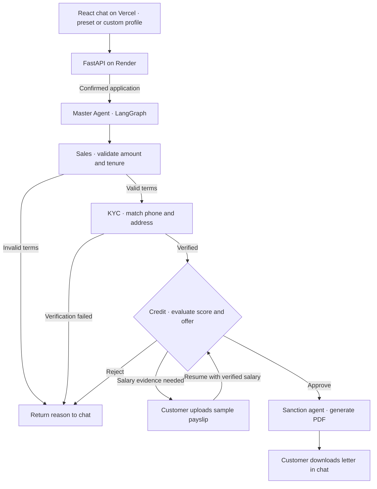

# LendBot AI

LendBot simulates a personal loan application for an Indian NBFC. In one chat, a customer can compare monthly instalments (EMIs), confirm loan terms, complete simulated KYC and download a PDF sanction letter if approved.

[Try the live chatbot](https://loan-chatbot-nine.vercel.app/) · [Watch the demo](docs/LendBot-demo.mp4)

## Try an application

- **Use a demo customer** to try one of [10 preset profiles](backend/app/services/customers.csv). For a salary-slip example, request ₹3,00,000 with PAN `ABCDE1234F`, monthly income ₹60,000 and a 24-month tenure. Confirm phone `0000000001` and address `11 Demo Lane`, then download and upload the sample payslip.
- **Use my own profile** to enter a fictional name, phone, address, salary, credit score and pre-approved limit. Use those contact details again when prompted for KYC. Both paths use the same lending rules.

## Architecture and stack



Vite builds the frontend. ReportLab generates sanction letters. SQLAlchemy stores chat history, decisions and PDFs in SQLite locally, with PostgreSQL supported for shared deployments.

Scikit-learn classifies chat intent. Gemini is optional for conversational wording. The underwriting rules run in Python.

| After KYC, apply the first matching rule | Outcome |
| --- | --- |
| Score below 700/900 or amount above 2× the limit | Reject |
| Amount within the pre-approved limit | Approve |
| Amount above the limit and up to 2× the limit | Request a sample payslip. Approve if EMI is at most 50% of verified salary. Otherwise reject. |

## Run locally

Use Python 3.11 and Node.js 22. Run these commands in **two PowerShell terminals**, starting at the repository root.

**Backend**

```powershell
cd backend
python -m venv .venv
.\.venv\Scripts\python -m pip install -r requirements.txt
Copy-Item .env.example .env
.\.venv\Scripts\python -m uvicorn app.main:app --port 8000
```

**Frontend**

```powershell
cd frontend
npm ci
npm run dev
```

Open the [local chatbot](http://localhost:5173) or [interactive API docs](http://localhost:8000/docs). For hosting, set `VITE_API_URL` to the API origin, `ALLOWED_ORIGIN` to the frontend origin and `DATABASE_URL` to the shared database URL.

**Checks:** From `backend`, run `.\.venv\Scripts\python -m pytest -q`. From `frontend`, run `npm run lint` and `npm run build`. For Playwright browser tests, install Chrome, set `LENDBOT_PYTHON` to the backend virtual environment’s Python executable and run `npm run test:e2e`.
