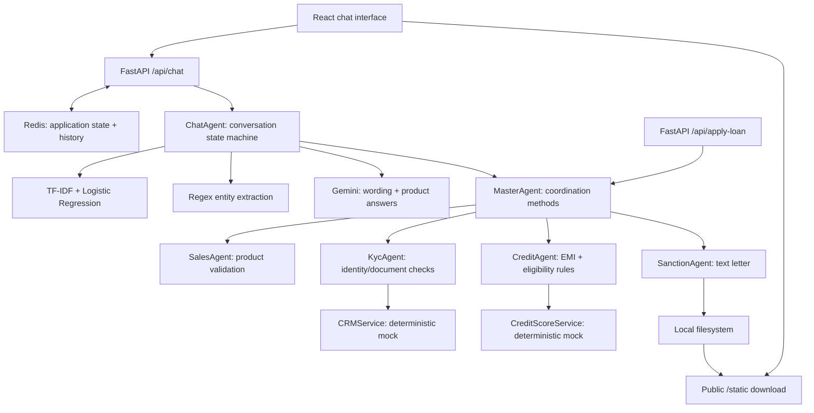

# AI Loan Processing Chatbot

End-to-end personal loan application system powered by multi-agent AI architecture. Conversational interface guides customers through KYC, eligibility checks, and sanction letter generation.

## Overview

Customers start a chat, provide PAN/income/loan amount conversationally, and receive approval, rejection or a request for salary evidence. Backend uses specialized AI agents that collaborate at each stage:
- **Sales Agent** explains products, validates loan parameters early
- **KYC Agent** validates PAN format real-time, verifies identity
- **Credit Agent** scores, calculates EMI, applies eligibility rules
- **Sanction Agent** generates text sanction letters

All loan logic is deterministic (no LLM in financial decisions). LLM only handles conversation naturalness.

## Tech Stack

| Layer | Technology |
|---|---|
| Frontend | React 19, Vite |
| Backend | FastAPI, Python 3.12 |
| LLM | Google Gemini 1.5 Flash (conversation only) |
| NLP | Intent Classification, Entity Extraction (PAN, income, loan amount, tenure) |
| Storage | Redis (session state) |
| Testing | pytest, pytest-asyncio |
| Deployment | Render (backend), Vercel (frontend) |

## Architecture



**Key flow:**
1. User provides PAN → KYC Agent validates format immediately
2. User provides income → Sales Agent context
3. User provides loan amount & tenure → Sales Agent validates parameters
4. User confirms → the Master routes through Sales, KYC and Credit, then calls Sanction on approval
5. Result: approval/rejection + downloadable sanction letter

## Quick Start

**Backend:**
```bash
cd backend
python -m venv venv
source venv/Scripts/activate  # or: venv\Scripts\activate (Windows)
pip install -r requirements.txt
export GEMINI_API_KEY=your_key_here
export REDIS_URL=redis://localhost:6379
export ALLOWED_ORIGIN=http://localhost:5173
uvicorn app.main:app --reload
```

**Frontend:**
```bash
cd frontend
npm install
npm run dev  # runs on http://localhost:5173
```

## Environment

`backend/.env`:
```env
GEMINI_API_KEY=your_gemini_api_key
REDIS_URL=redis://localhost:6379
ALLOWED_ORIGIN=http://localhost:5173
```

## Synthetic offers and underwriting

The CRM, offer mart and bureau share ten synthetic profiles in
`backend/app/services/customers.csv`. Prospect records represent campaign leads
with seeded offers. An unknown PAN stops at verification. The mock systems
expose read-only views at `/api/mock/crm/{pan}`, `/api/mock/offers/{pan}` and
`/api/mock/bureau/{pan}`. Workers read the same records in-process.

After product and KYC checks, both chat and the direct application API use policy
`offer-v1`. Scores below 700 and requests above twice the offer limit are rejected.
Eligible requests up to the limit qualify immediately. Requests above the limit
through twice the limit require a salary slip. The policy compares EMI rounded
half-up to the nearest paise with half the verified monthly salary, accepting equality.
The deprecated client flag `is_preapproved` and self-reported income cannot satisfy this check.

| Demo PAN | Amount | Expected result |
|---|---:|---|
| ABCDE1234F | 200000 | Instant approval |
| ABCDE1234F | 200001 | Salary slip required |
| ABCDE1234F | 400001 | Above maximum |
| LOWSC0000X | 100000 | Score below threshold |

Use 24 months for these examples. A pending application returns `PENDING` from
`POST /api/apply-loan` or `AWAITING_SALARY_SLIP` in chat. Phase 1 implements
the policy and pending state. Upload/resume and PDF letters are later milestones.
The current identity check looks up a seeded PAN. Phone and address are available
in the CRM fixture for the upcoming KYC conversation.

## Testing

Run `python -m pytest -q` from `backend`.
